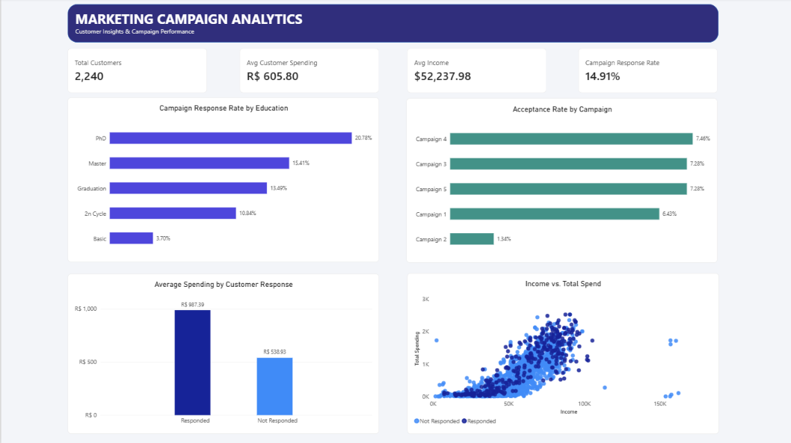
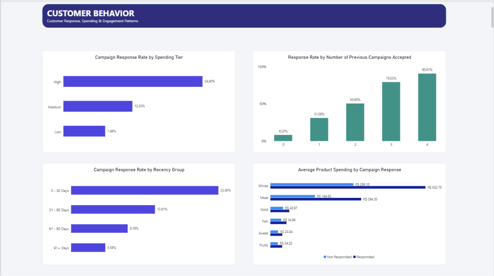
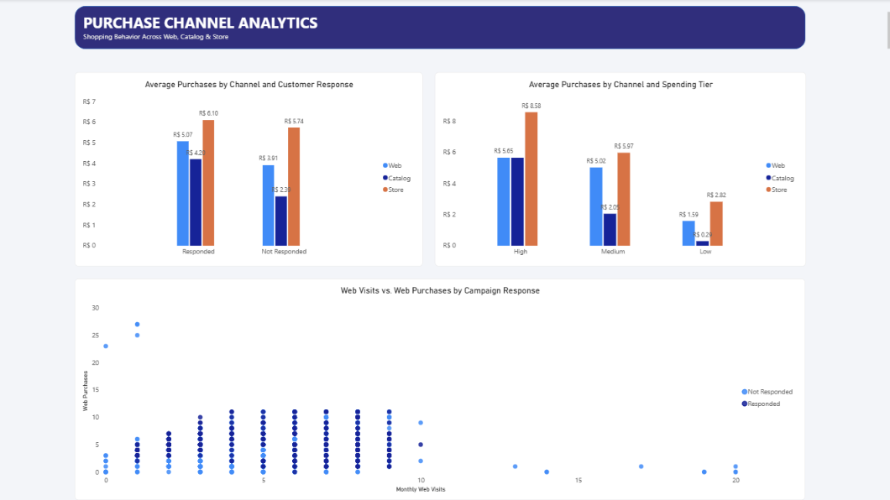

# Customer Personality Analysis

A data analytics portfolio project exploring customer purchasing behavior, customer segmentation, and marketing campaign performance using Python, SQL, and Power BI.

## Project Overview

This project analyzes customer demographics, purchasing patterns, product spending, and marketing campaign responses to identify customer segments with higher engagement and potential opportunities for more effective marketing strategies.

The project follows an end-to-end data analytics workflow, from data preparation and SQL analysis to interactive dashboard development and business recommendations.

## Business Objectives

- Analyze customer purchasing behavior and spending patterns.
- Identify customer segments with higher campaign response rates.
- Evaluate the relationship between previous campaign acceptance and current campaign response.
- Compare purchasing behavior across web, catalog, and in-store channels.
- Translate analytical findings into actionable marketing recommendations.

## Tools & Technologies

- **Python:** Data preparation and exploratory analysis using Jupyter Notebook.
- **PostgreSQL:** Data querying and analysis using SQL.
- **Power BI:** Interactive dashboards, KPI reporting, and data visualization.
- **Git & GitHub:** Version control and project documentation.

## Project Workflow

1. **Data Preparation:** Load and prepare the customer personality dataset.
2. **Exploratory Data Analysis:** Explore customer characteristics and purchasing behavior using Python.
3. **SQL Analysis:** Query and analyze customer and marketing data using PostgreSQL.
4. **Dashboard Development:** Build interactive Power BI dashboards to examine campaign performance, customer behavior, and purchase channels.
5. **Business Insights:** Summarize key findings and develop data-driven marketing recommendations.

## Dashboard Preview

### 1. Marketing Campaign Overview

Provides an overview of customer metrics, campaign response rates by education, campaign acceptance rates, average spending by customer response, and the relationship between income and total spending.



### 2. Customer Behavior

Explores campaign response rates across spending tiers and recency groups, the relationship between previous campaign acceptance and response rates, and average spending across product categories.



### 3. Purchase Channel Analysis

Compares average purchasing activity across web, catalog, and in-store channels based on customer response and spending tier. The page also explores the relationship between monthly web visits and web purchases.



## Key Findings

Based on the current Power BI dashboard:

- **Overall campaign response rate:** 14.91% across 2,240 customers.
- **Spending tier:** Customers in the high-spending tier have a 24.90% response rate, compared with 12.35% for medium-spending customers and 7.49% for low-spending customers.
- **Purchase recency:** Customers who purchased within the last 30 days have a 23.90% response rate, compared with 5.56% among customers in the 91+ day group.
- **Previous campaign acceptance:** The response rate increases from 8.22% among customers with zero previously accepted campaigns to 90.91% among customers with four previously accepted campaigns.
- **Product spending:** Responding customers have higher average wine spending (502.70) and meat spending (294.35) than non-responding customers (269.10 and 144.62, respectively).
- **Purchase channels:** In-store purchasing activity is higher on average than web and catalog purchasing activity across the customer response groups shown in the dashboard.

## Business Recommendations

1. **Prioritize high-spending customers.** Test targeted campaigns for high-value customers while developing suitable offers for medium- and low-spending segments.
2. **Improve customer re-engagement.** Explore personalized promotions for customers who have not purchased recently.
3. **Use campaign history for targeting.** Consider previous campaign acceptance when prioritizing customer segments for future campaigns.
4. **Personalize product promotions.** Explore targeted offers for wine and meat products based on observed spending patterns.
5. **Optimize purchase channels.** Maintain the in-store channel while identifying opportunities to improve web and catalog engagement.

These recommendations are proposed opportunities based on observed patterns, not proven causal effects.

## Repository Structure

```text
customer-personality-analysis/
├── data/
│   └── Dataset files
├── images/
│   ├── overview.png
│   ├── customer_behavior.png
│   └── purchase_channel_analysis.png
├── notebooks/
│   └── customer_personality.ipynb
├── powerbi/
│   └── Power BI report files
├── sql/
│   └── SQL analysis scripts
├── .gitattributes
├── .gitignore
└── README.md
```

## Project Files

- **`notebooks/`** — Jupyter Notebook containing Python-based data preparation and analysis.
- **`sql/`** — SQL scripts for querying and analyzing the dataset.
- **`powerbi/`** — Power BI report containing three dashboard pages.
- **`images/`** — Dashboard screenshots displayed in this README.
- **`data/`** — Dataset files used in the project.

## Conclusion

This project demonstrates an end-to-end data analytics workflow by combining Python, PostgreSQL, and Power BI to explore customer behavior and marketing campaign performance. The resulting analysis provides a foundation for understanding customer engagement, comparing purchasing patterns, and developing more targeted marketing strategies.

